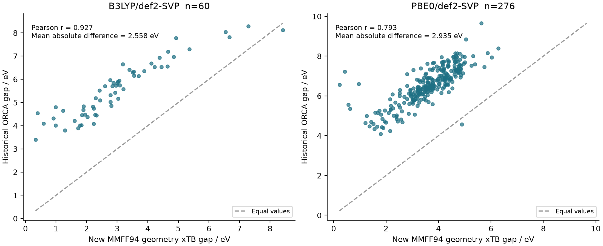
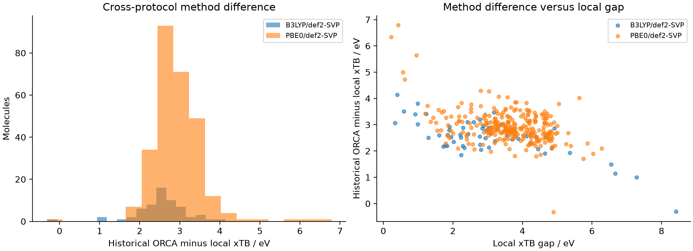
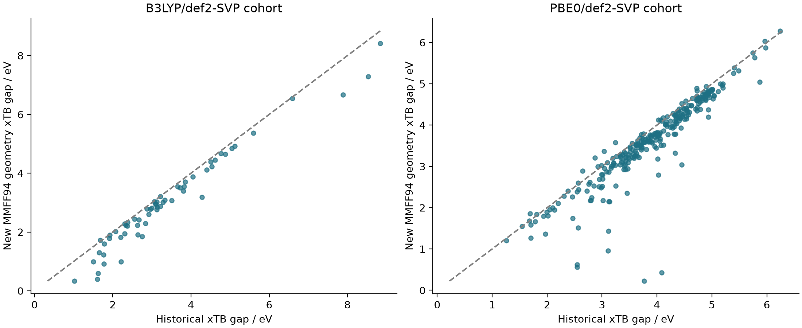
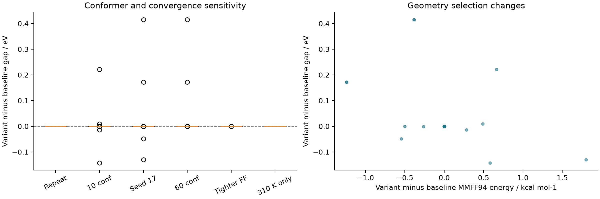
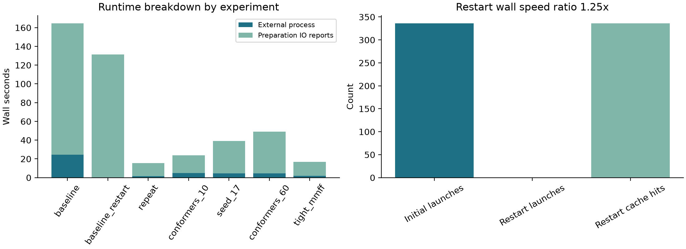
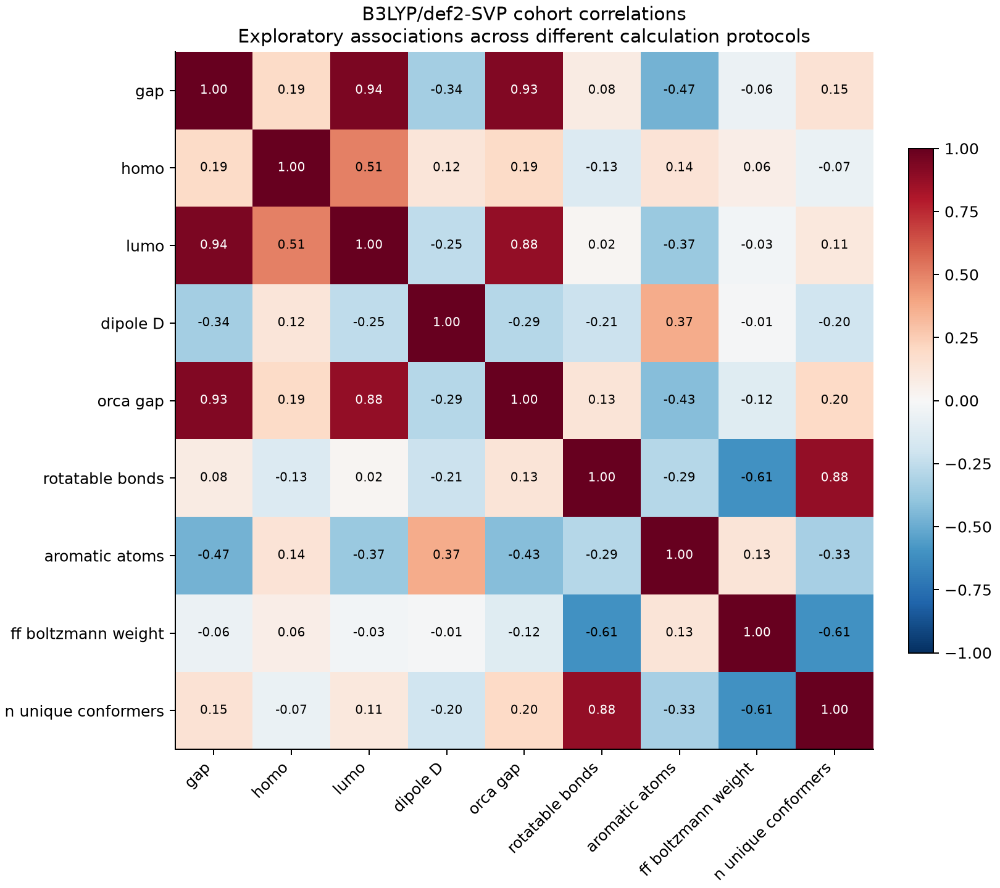
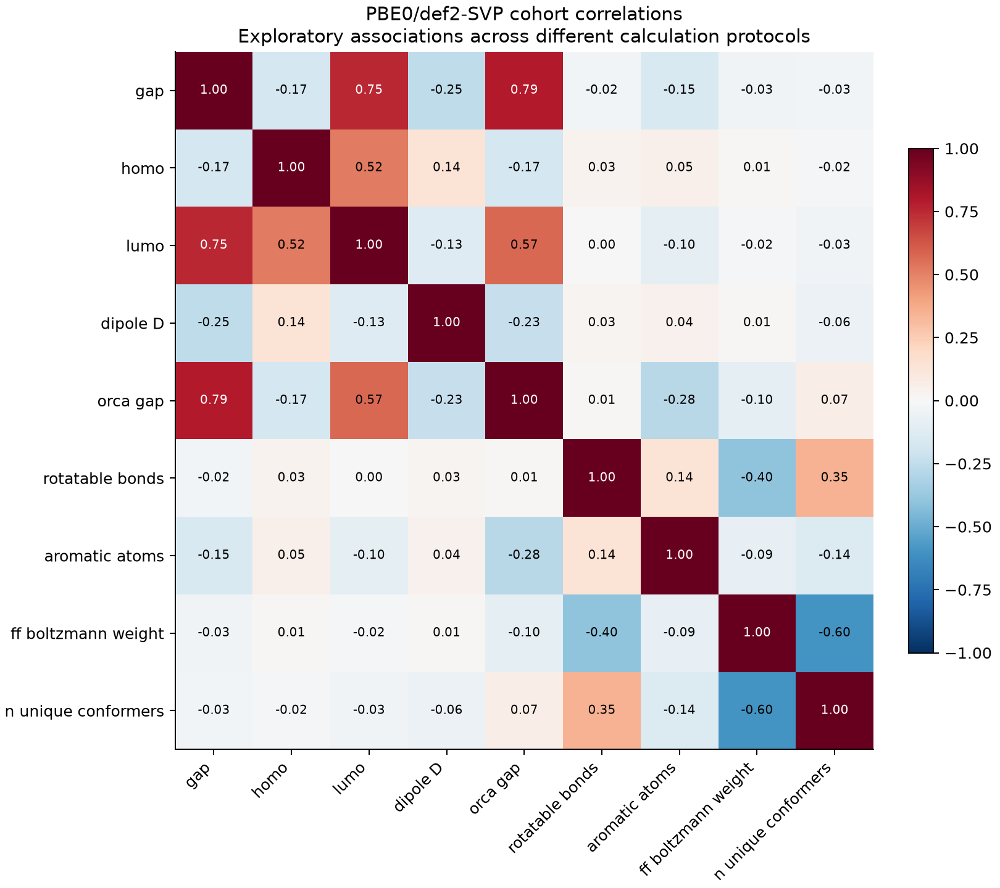
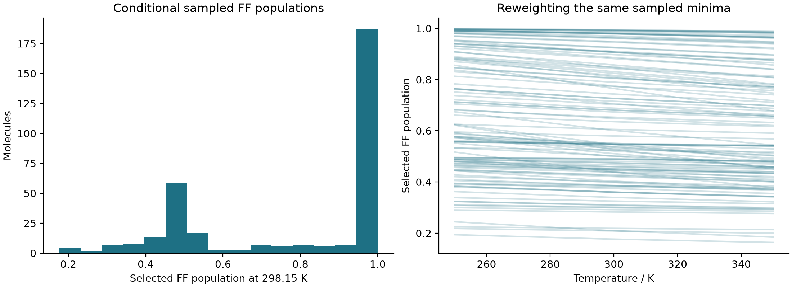
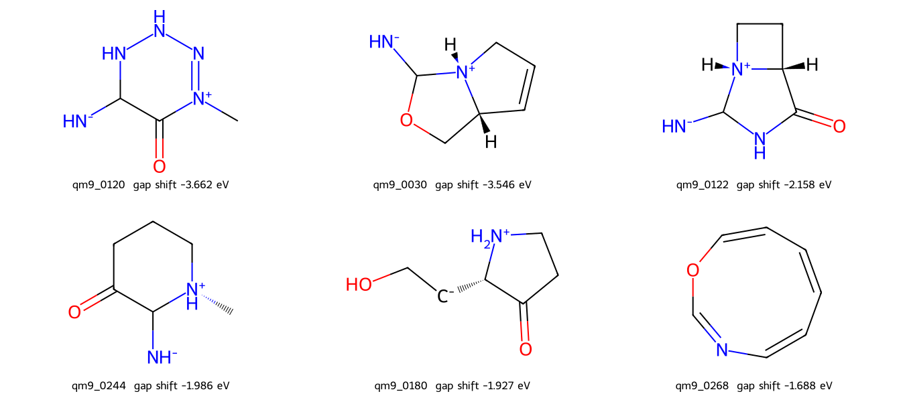

# MolCurator intensive local xTB analysis

21 October 2026. Local experiments; evidence published to the existing tool branch. No new pull request was created for this analysis.

Input: 336 distinct molecules; xTB successes 336; failures 0.
Completed 14 experiments in 473.3 seconds. ORCA calls: 0.

## Scope and evidence

Real official Windows xTB 6.7.1pre calculations on selected MMFF94 geometries. CSV and reports are produced with plots off by default; analysis figures below were explicitly requested and enabled.
The source contains 60 B3LYP/def2-SVP labels with recorded ok status and 276 historical PBE0/def2-SVP labels with unknown convergence status. All 336 canonical structures are distinct, neutral and closed shell. This dataset cannot reproduce the colleague's 42 suspected radicals or 8 conformer failures; separate negative controls test rejection behavior.
Historical ORCA and xTB geometry protocols differ from this local single-point workflow. Method differences are cross-protocol diagnostics, not experimental prediction errors. Local-versus-archived xTB differences can combine geometry protocol, software/build/platform and undocumented historical runtime effects; they cannot be attributed to geometry alone. No production correction or ML model was trained.

## Raw method comparisons

| dataset | reference_method | pearson_ci_low | pearson_ci_high | n | pearson_r | spearman_r | mean_reference_minus_local_ev | median_reference_minus_local_ev | mean_absolute_difference_ev | rmse_difference_ev | p95_absolute_difference_ev | exploratory_ipw_absolute_difference_ev | sum_inverse_probability_weights |
| --- | --- | --- | --- | --- | --- | --- | --- | --- | --- | --- | --- | --- | --- |
| b3lyp_validation60 | dft:B3LYP/def2-SVP | 0.89809 | 0.9538 | 60 | 0.92735 | 0.94354 | 2.5484 | 2.5844 | 2.5585 | 2.635 | 3.4738 | 2.3384 | 568 |
| historical_pbe0_276 | dft:PBE0/def2-SVP | 0.71069 | 0.86412 | 276 | 0.79278 | 0.82804 | 2.9326 | 2.8535 | 2.9349 | 3.0002 | 3.8046 | nan | nan |

Pearson confidence intervals are 2000-resample within-cohort descriptive bootstrap intervals, not design-corrected estimates for the original screening pool. Correlations are exploratory, not causal evidence. Gap correlations with HOMO and LUMO partly reflect the algebraic definition gap = LUMO minus HOMO and do not independently validate prediction quality. B3LYP inverse-probability-weighted discrepancy is reported separately in statistics.json; the original stratified sampling design limits population claims.

## Repeatability and sensitivity

| case | n_requested | n_paired | failed | mean_delta_ev | median_absolute_delta_ev | p95_absolute_delta_ev | max_absolute_delta_ev | count_absolute_delta_gt_0_1ev | count_absolute_delta_gt_0_5ev | pearson_with_baseline | mean_delta_ff_energy_kcal_mol |
| --- | --- | --- | --- | --- | --- | --- | --- | --- | --- | --- | --- |
| repeat | 24 | 24 | 0 | 0 | 0 | 0 | 0 | 0 | 0 | 1 | 0 |
| conformers_10 | 60 | 60 | 0 | 0.0012374 | 2.8843e-06 | 0.0097822 | 0.22124 | 2 | 0 | 0.99978 | 0.033591 |
| seed_17 | 60 | 60 | 0 | 0.0067804 | 3.412e-06 | 0.052611 | 0.41486 | 3 | 0 | 0.99932 | -0.018952 |
| conformers_60 | 60 | 60 | 0 | 0.0097842 | 0 | 2.534e-05 | 0.41487 | 2 | 0 | 0.99938 | -0.027097 |
| tight_mmff | 24 | 24 | 0 | -1.465e-05 | 2.7704e-06 | 4.9677e-05 | 0.00028198 | 0 | 0 | 1 | -6.438e-09 |
| temperature_310 | 24 | 24 | 0 | 0 | 0 | 0 | 0 | 0 | 0 | 1 | 0 |

Parameter changes are compared on matched IDs only. Different conformer counts or seeds can select different geometries. Temperature curves reweight a held FF ensemble and do not launch new electronic calculations.

## Runtime and restart

| case | rows | success | fresh_xtb_calls | cache_hits | wall_s | process_s | preparation_io_reporting_s |
| --- | --- | --- | --- | --- | --- | --- | --- |
| baseline | 336 | 336 | 336 | 0 | 164.55 | 24.596 | 139.95 |
| baseline_restart | 336 | 336 | 0 | 336 | 131.54 | 0 | 131.54 |
| repeat | 24 | 24 | 24 | 0 | 15.567 | 1.61 | 13.957 |
| conformers_10 | 60 | 60 | 60 | 0 | 23.647 | 4.78 | 18.867 |
| seed_17 | 60 | 60 | 60 | 0 | 39.11 | 4.656 | 34.454 |
| conformers_60 | 60 | 60 | 60 | 0 | 48.878 | 4.611 | 44.267 |
| tight_mmff | 24 | 24 | 24 | 0 | 16.948 | 1.892 | 15.056 |
| negative_controls | 8 | 1 | 1 | 0 | 0.57856 | 0.063 | 0.51556 |
| timeout_control | 1 | 0 | 1 | 0 | 0.29785 | 0 | 0.29785 |
| missing_binary_control | 1 | 0 | 0 | 0 | 0.22614 | 0 | 0.22614 |
| corruption_initial | 1 | 1 | 1 | 0 | 0.40204 | 0.063 | 0.33904 |
| corruption_recovery | 1 | 1 | 1 | 0 | 0.43831 | 0.078 | 0.36031 |
| temperature_initial | 24 | 24 | 24 | 0 | 14.609 | 1.547 | 13.062 |
| temperature_310 | 24 | 24 | 24 | 0 | 16.029 | 1.61 | 14.419 |
Wall times are diagnostic observations from one local session, not a controlled hardware benchmark; automated tests overlapped parts of the early passes. Restart avoided all additional electronic calls; wall speed ratio initial/restart = 1.25. Preparation and IO are still repeated, so caching does not eliminate all runtime.

## Negative controls

| candidate_id | xtb_status | xtb_error |
| --- | --- | --- |
| neutral_control | ok |  |
| radical_methyl | failed | ValueError: iteration 1 supports neutral closed-shell molecules only |
| radical_oxygen | failed | ValueError: iteration 1 supports neutral closed-shell molecules only |
| charged_ammonium | failed | ValueError: iteration 1 supports neutral closed-shell molecules only |
| charged_acetate | failed | ValueError: iteration 1 supports neutral closed-shell molecules only |
| disconnected | failed | ValueError: one valid connected molecule required |
| invalid | failed | ValueError: one valid connected molecule required |
| no_mmff | failed | ValueError: MMFF94 parameters unavailable; no alternative force field is used |
A separate temperature-only cache check repeated 24 molecules at 310 K: geometry bytes and gaps stayed identical, but the conservative full-settings key launched 24 new calculations. This identifies a cache dependency improvement opportunity rather than a numerical failure. Additional controls exercised a real process timeout, missing executable and corrupted cached log followed by recalculation. Original baseline artifacts were preserved.

## Screening caution

| dataset | n | reference_positives | local_selected | true_positive | false_positive | false_negative |
| --- | --- | --- | --- | --- | --- | --- |
| b3lyp_validation60 | 60 | 1 | 8 | 0 | 8 | 1 |
| historical_pbe0_276 | 276 | 0 | 53 | 0 | 53 | 0 |
The historical B3LYP cohort has only one reference-positive molecule in the 3.0 to 3.5 eV window. These counts cannot establish reliable recall. PBE0 labels retain unknown convergence status.

## Files and units

tables/molecular_results.csv contains per-molecule predictions, historical labels, descriptors, explicit HOMO/LUMO/dipole extractions and provenance. All orbital quantities and gaps are eV; dipoles are Debye; FF energies kcal/mol; runtimes seconds. Missing entries remain blank. Other CSVs hold paired sensitivity data, correlations, timings, window counts and controls. statistics.json and provenance.json provide machine-readable evidence and source hashes.
Raw process inputs, logs and attempt records remain in the task checkout under .tools/intensive-local. Reproduction scripts assume the repository root as working directory. The provided source CSV is already present in the repository.

## Figures

