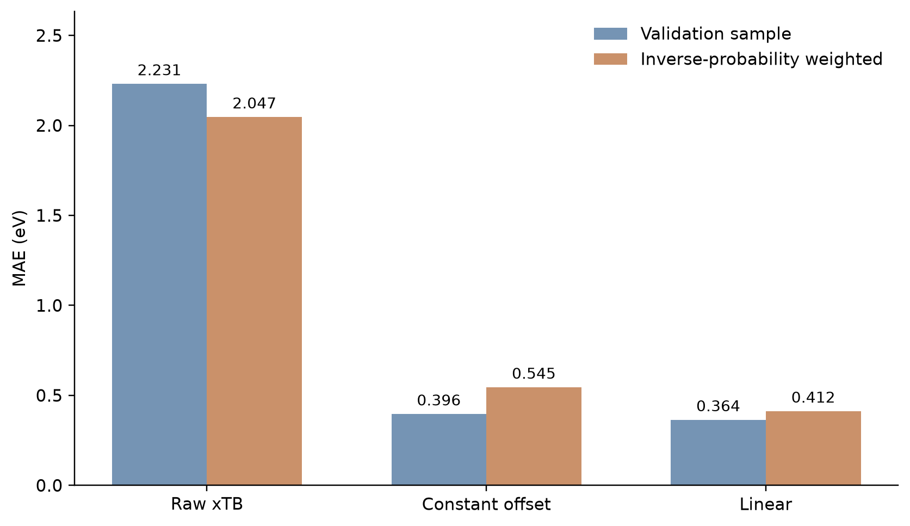
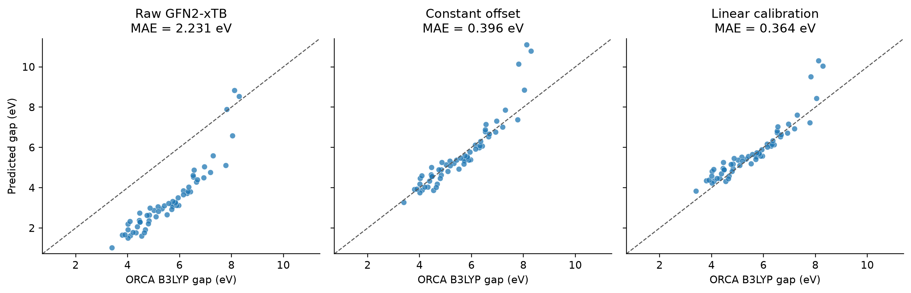
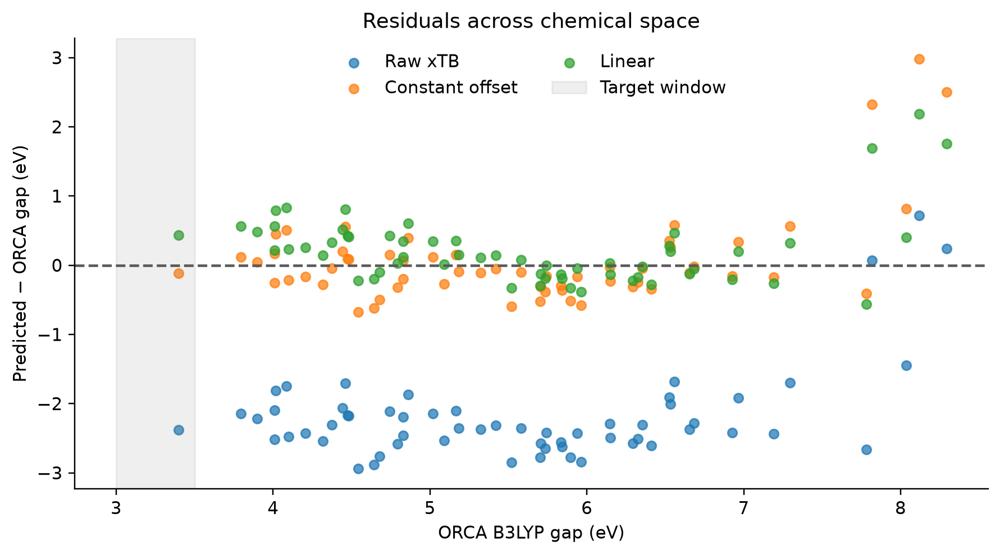
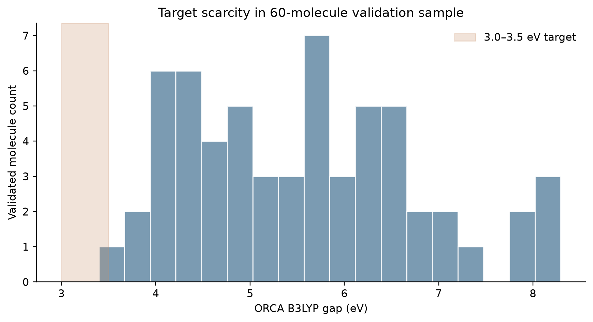
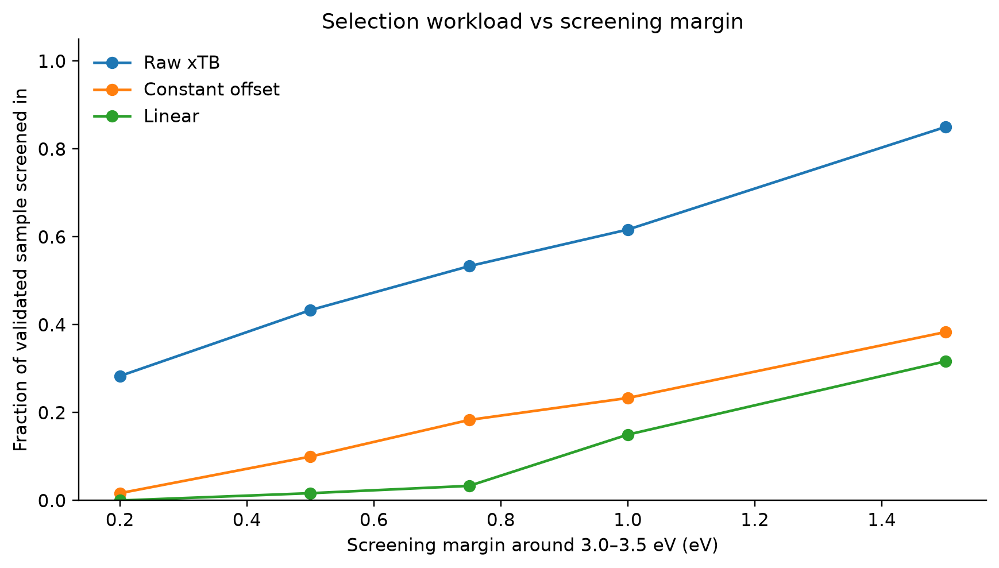
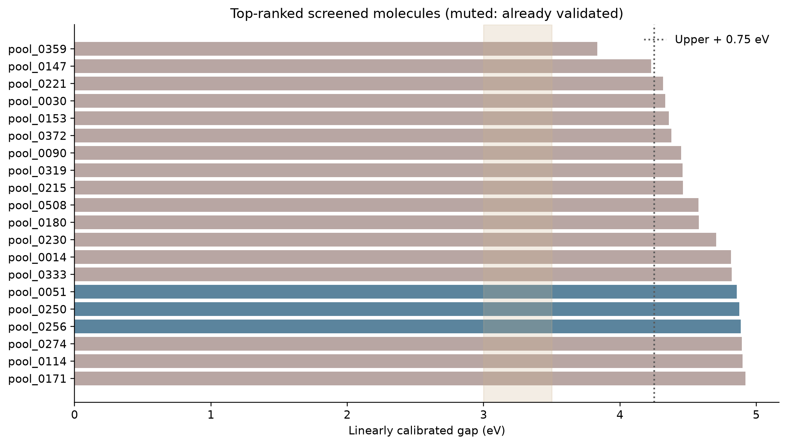

# MolCurator — HOMO–LUMO Gap Calibration and Validation

**Method:** GFN2-xTB optimized geometry, ORCA B3LYP/def2-SVP single-point HOMO–LUMO orbital gap.

## Research summary

Our property-validation adapters completed 24/24 initial calibration calculations and 60/60 target-enriched ORCA validations. The screening pool had 568 successful xTB calculations out of 600 selected candidate molecules. The fixed 24-molecule calibration experiment trained a constant-offset and linear gap correction; this subsequent 60-molecule evaluation was selected using strata defined by distance to the calibrated target.

## Calibration models

- Constant offset: $E_{DFT}^{pred}=E_{xTB}+2.261744$ eV.
- Linear: $E_{DFT}^{pred}=0.827078 E_{xTB}+2.990190$ eV.
- Target: **3.0–3.5 eV**, with a provisional **±0.75 eV** ranking margin.

## Validation metrics

| Method | Sample MAE (eV) | Inverse-probability-weighted MAE (eV) |
|---|---:|---:|
| Raw GFN2-xTB | 2.231 | 2.047 |
| Constant offset | 0.396 | 0.545 |
| Linear calibration | 0.364 | 0.412 |

## Screening and target hits

The validation sample contains **1** confirmed hit(s) in the 3.0–3.5 eV target window. The top-ranked screened structures were largely already covered by the target-enriched validation cohort. The frozen sample probabilities support design-weighted estimates of prediction error, **not a guarantee of screening recall**. With just 1 observed hit(s), empirical hit recall is highly uncertain.

| Candidate ID | ORCA gap (eV) | xTB gap (eV) | Linearly calibrated gap (eV) |
|---|---:|---:|---:|
| pool_0359 | 3.3968 | 1.0192 | 3.8332 |

## Interpretation and implementation notes

The calibrated models substantially reduce the systematic offset between xTB and B3LYP orbital gaps. Linear calibration performs best on this validation cohort; these coefficients are **method specific** and should not be applied to PBE0 results, vertical S1 energies or S1–T1 gaps. The shared agent contract remains unchanged: `Prediction.value` is the raw xTB gap, and a separate screening layer applies the calibration for ranking. One xTB-selected FF-minimum geometry is passed to one ORCA attempt per validation candidate.

**Limitations:** the target-enriched validation cohort is not a simple random sample; QM9 chemical space is narrow; just 1 observed hit(s) cannot establish recall; sampling and model fit uncertainty are not estimated here. A broader, positive-enriched and independently probability-sampled validation campaign is required before any hard rejection policy.

## Reproducibility and provenance

Inputs are the saved `validation_results.csv` (60 ORCA labels) and `calibrated_ranking.csv` (screened-pool ranking); the earlier 24-molecule results provide frozen calibration coefficients. Figures and `statistics.json` can be regenerated using `scripts/build_property_report.py`.
